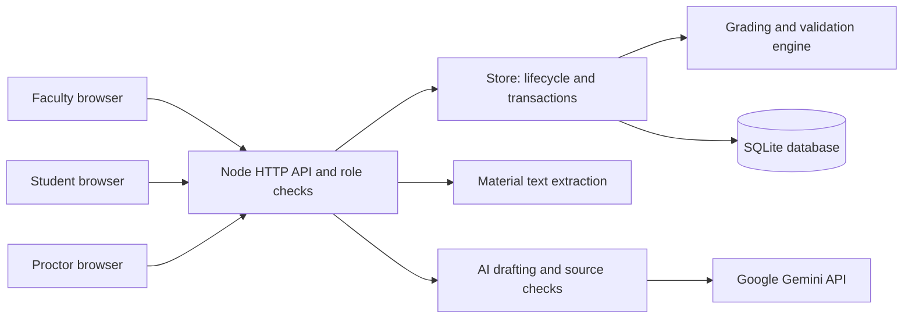
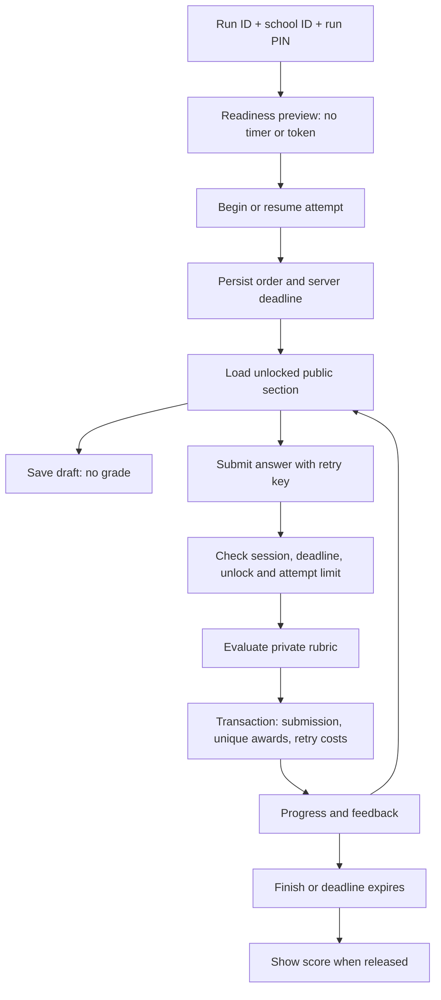

**Got It! system audit — 2 November 2026**

**Remediation update:** Findings 1 and 3–7 below have been fixed in the working tree, with regression tests for classroom admission, score recovery, identifiers, UTF-8, session revocation/storage, configuration selection, and maintenance cleanup. Browser sessions now use HttpOnly cookies and run PINs remain only in the current Faculty page's memory. Finding 2's school-ID/shared-PIN identity model is retained at the user's explicit request because all activities are proctored. The report below preserves the original audit snapshot; [verification.json](../artifacts/audit-2026-11-02/verification.json) records the corrected probe outcomes and [the API documentation](API.md) describes current behavior.

Remediation validation: **83/83 tests passed**, required formatting and diff whitespace checks passed, and isolated Chrome checks covered Faculty sign-in/refresh/logout, student draft restoration and logout, and Proctor monitoring/logout. The 500-student admission regression uses sequential requests; concurrency and the other original deployment gates remain unverified. Restart the application to load backend changes. Legacy student access without expiry requires one rejoin; the original attempt and deadline are preserved. Copy run access details before refreshing or leaving Faculty, because run PINs are no longer persisted.

This repository is a working assessment application with a small deployment footprint: browser pages, one Node.js process, and one SQLite database. Its strongest controls are server-owned grading, immutable published versions, transactional score awards, and separation of faculty, student, and proctor APIs. It remains a supervised prototype. Classroom admission throttling and identity assurance need attention before a real graded rollout, along with the concrete defects below.

The audit covers the current working tree in `D:\code\ctfv1`, including its existing uncommitted changes. It combines source and documentation review, the existing automated suite, production dependency advisory checks, read-only database checks, and isolated reproductions. It does not certify a deployed host or constitute a penetration test. No application implementation or existing assessment records were changed. The new audit files contain fictional diagnostic records only; environment secrets and student-level records are not reproduced here.

**Stack and responsibilities**

| Layer | Implementation | Responsibility / entry point |
|---|---|---|
| Browser UI | HTML, CSS, native JavaScript modules | Separate `/app/faculty`, `/app/student`, and `/app/proctor` pages; no frontend build step |
| Table UI | Locally vendored DataTables 3.1.4 | Faculty roster tables and student table-code previews |
| HTTP application | Node.js 22.13+; tested here with 22.14.0; native `node:http` | `src/server.mjs`: configuration, routing, role checks, rate limits, request IDs, JSON and CSV responses, static assets |
| Application and persistence | `src/store.mjs` | Assessment lifecycle, classes, runs, admission, sessions, progress, score accounting, recovery, reporting |
| Grading | `src/engine.mjs` | Package validation, mission order, answer evaluation, retry policies; uses `public/table-code.js` as a bounded parser |
| Database | Built-in `node:sqlite`, synchronous API, SQLite WAL | `src/store-schema.mjs`: table creation and incremental startup alterations |
| Material extraction | `pdfjs-dist` 6.4.299; `fflate` 0.8.3 | `src/materials.mjs`: PDF text and PPTX slide XML; UTF-8 text/Markdown supported directly |
| Optional AI | Gemini REST API through native `fetch` | `src/ai.mjs`: draft questions and advisory source checks; configured model defaults to `gemini-3.5-flash` |
| Tests and CI | `node:test`, Prettier, GitHub Actions | CI installs dependencies, checks formatting of three selected files, and runs tests on Node 22 |

There is no application framework, ORM, queue, distributed cache, institution identity provider, or automated deployment pipeline in the inspected checkout. The service binds to loopback by default. The browser and API are served from the same process and origin. `npm start` starts that process; `npm run dev` adds Node's watch mode.



SQLite, application files, and the Node process form the main local trust boundary. Gemini is the additional external boundary: generation sends source text and setup; source checks also send draft prompts and correct answers. The API key remains on the server. Model availability, provider behavior, and live generation were not exercised during this audit. AI tests use controlled responses.

**The concepts that explain the system**

| Concept | Meaning | Storage |
|---|---|---|
| Assessment / activity package | Subject, prompts, missions or sections, question configuration, and private grading criteria | Versioned `exams` rows with public and private JSON |
| Source | Extracted teaching text and optional review notes attached to a version | `source_documents`; original PDF/PPTX binary is not retained |
| Class | Editable student roster for reuse | `classes`, `class_students` |
| Run | A scheduled delivery of one published version to a copied roster | `runs`, `roster` |
| Attempt / session | One student's participation in one run | `sessions`; unique `(run_id, candidate_id)` |
| Draft | Saved, unsubmitted answer; does not earn points | `answer_drafts` |
| Submission | A recorded answer attempt and automatic outcome | `submissions` |
| Score | Unique criterion awards, less retry penalties, with optional faculty replacements | `score_events`, `penalty_events`, `score_overrides` |
| Access and audit | Hashed bearer tokens, recoverable AI previews, lifecycle records | Instructor/proctor token tables, `ai_proposals`, `audit_events` |

An assessment version is content; a run is its delivery; a session is one student's attempt. Editing a class changes future runs. Existing run rosters are snapshots. Revising a published assessment requires a new draft version, and existing runs continue to reference their original version.

“Private grading” means the API restricts access and the files are outside static serving. The SQLite private JSON column is ordinary stored data, not an encrypted vault. Anyone with database or server filesystem access can read it.

**Faculty flow**

1. Sign in using the configured shared faculty password. The server issues an eight-hour bearer token and stores its hash.
2. Import public/private JSON, or upload teaching material and request an AI proposal. Faculty can edit and approve selected questions. The AI source-match percentage is advisory; publication does not depend on a high percentage.
3. Save a draft. Runtime validation checks grading formats, point totals, dependencies, source-file existence, and answer-like public field names. The JSON Schema files document the contract; runtime enforcement comes from the handwritten validator.
4. Explicitly publish the draft. The application computes a content hash and blocks later edits through its draft APIs. Publication is an application-level rule, not a database trigger.
5. Create or select a class, then create a run with its roster, admission PIN, joining window, feedback mode, and optional within-section question shuffle.
6. Review participation, inspect answers and the private answer key, export CSV, and use audited recovery or score adjustments. A score replacement requires an ended attempt, bounded points, and a reason.
7. Publish completed students' scores individually or in bulk. Scores also become visible automatically when the run closes. Proctor access uses a separately issued run code.

The Faculty UI defaults new runs to Graded. API callers that omit `feedbackMode` receive Practice for compatibility. This is an important difference for scripted integrations.

**Student flow and grading**



Readiness and joining use the same credentials. First join fixes mission order, optionally shuffles questions within each mission, and sets the deadline to the earlier of the assessment duration and run close. Rejoining preserves progress and deadline but rotates the student's token. The browser holds the token in session storage.

Sections unlock in the persisted order when every question in the prior section has a submission and dependencies are satisfied. Completion means submitted, not correct. A wrong answer can therefore unlock the next section. Mission shuffling is controlled by package shuffle groups; within-mission question shuffling is a separate run setting.

The browser saves initial answer drafts after a short delay. Drafts are not final submissions and are excluded from grades. After a first submission, edits remain local until another submission; the current implementation does not persist revised drafts for previously submitted questions. The UI warns about these unsubmitted revisions.

On submit, the store evaluates against the published private rules. A `BEGIN IMMEDIATE` transaction records the submission, inserts newly earned criterion events, clears the initial draft, and applies retry point/time costs. A stable idempotency key plus response hash prevents a transport retry from consuming another attempt. The unique score-event primary key prevents awarding the same criterion twice.

Scores retain each criterion once earned. They are not recomputed solely from the latest answer. For questions with partial credit, different submissions can accumulate different criterion awards; retries still incur configured costs. The overall score is floored at zero, while a question's automatic points can be negative after penalties. These are existing grading semantics that faculty should confirm suit each assessment.

Nine manual activity types are implemented: single choice, multiple choice, true/false, text, numeric, matching, sequencing, data inspection, and DataTables code. AI generation supports six of these: the choice, boolean, text, numeric, and sequencing types. Table code is parsed into supported options and calls. It is not executed as arbitrary student JavaScript, and grading computes visible rows from server fixtures.

Practice gives immediate correctness and score. Graded gives submission confirmation and withholds the score until faculty publication or run close, subject to the recovery defect below. Finalizing does not submit outstanding drafts. Expiration is derived from the server deadline when views and mutations are requested; a background scheduler is not required for enforcement. The browser countdown is a display and can differ if the client clock is inaccurate.

**Proctor flow**

Faculty chooses an 8–100 character code for a run. The server stores its SHA-256 hash; a proctor signs in using run ID and code. A proctor token is limited to that run and expires at the earlier of eight hours and run close. Replacing or revoking access deletes existing tokens. The monitoring view polls every 15 seconds and exposes names, IDs, participation, progress, last submission, and time remaining. It excludes answers, scores, and faculty controls. “In progress” does not prove the student's browser is currently online.

**Verified evidence**

| Check | Result |
|---|---|
| Existing automated suite | **71/71 passed** on Node 22.14.0 with local loopback access |
| Initial sandbox-only test run | 53 passed; 18 HTTP tests could not connect. The permitted rerun passed all 18. |
| `npm run format:check` | Passed; covers only `public/paper-copy.js`, `public/password-toggle.js`, and `src/store-schema.mjs` |
| `npm audit --omit=dev --json` | Zero known production dependency advisories reported on the audit date; this does not analyze vendored DataTables or prove absence of vulnerabilities |
| Configured checkout database | `data/recovered-studio-20261102.sqlite`, opened read-only; `PRAGMA quick_check` returned `ok`; zero foreign-key violations |
| Database aggregate snapshot | 4 assessment versions, 1 class, 9 runs, 5 sessions, 21 submissions; no student-level details collected in this report |
| Isolated probes | Shared-IP blocking, token rotation using shared credentials, reopened-score visibility, unreachable published ID, UTF-8 corruption, and absent faculty logout endpoint reproduced |

The configured file comes from this checkout's environment. This does not establish that an independently started server uses the same configuration. Both `studio.sqlite` and the recovered database exist. Audit probes use a separate in-memory database and never open either existing file for writes.

Reproduction command, from the repository root:

```powershell
node --experimental-sqlite artifacts/audit-2026-11-02/reproduce.mjs
```

See [the probe](../artifacts/audit-2026-11-02/reproduce.mjs) and [its evidence](../artifacts/audit-2026-11-02/evidence.json). The probe asserts the currently observed defects, so an assertion may stop passing after a fix; it is a diagnostic, not a permanent regression suite.

**Prioritized findings**

1. **P1 — Shared-IP admission throttling blocks normal classroom entry.** `src/server.mjs:259–262` uses one 20-request/minute bucket for readiness and join, keyed only by `req.socket.remoteAddress`. Successful requests count too. In the reproduction, ten students used two requests each; students 11 and 12 received HTTP 429 at readiness. A lab behind NAT can hit this directly. A reverse proxy can concentrate more users into the same bucket because no trusted proxy client-address policy exists. Use layered limits appropriate to failed credential attempts and candidate/run identity, with a classroom-capable IP ceiling, bounded limiter storage, and an explicit proxy policy. Add a regression covering an entire class on one IP. [OWASP authentication guidance](https://cheatsheetseries.owasp.org/cheatsheets/Authentication_Cheat_Sheet.html#login-throttling) supports account-aware throttling and balancing denial-of-service risks.

2. **P1 before real graded use — Credentials do not establish individual identity.** `src/store.mjs:482–521` accepts a roster school ID plus one shared run PIN. A classmate with the run PIN and another student's school ID can resume that student's attempt and rotate out their token; the probe confirms the original token becomes unauthorized. Faculty has one shared password and generic audit identity, so changes cannot be attributed to an individual staff member. Demo mode defaults on, with the documented faculty fallback password. This is an acknowledged design limit in `docs/SECURITY.md`, not evidence of an external compromise. Use institution identity and staff-specific accounts before real grades, disable demo access in deployment, and keep transport and server storage access controlled. PIN hashes are fast unsalted SHA-256; short PINs remain easy to guess offline if the database is obtained.

3. **P2 — Reopening a published graded attempt preserves live score visibility.** `src/store.mjs:580–581` releases scores whenever `results_published_at` is populated. Recovery at `src/store.mjs:859–861` sets the attempt back to `in_progress` without clearing that field. The probe records a reopened active attempt with score 50; another correct submission changes its visible score to 100 while the run remains open. That allows correctness inference from score changes despite Graded mode. Clear the release marker as part of recovery and make the release policy explicitly account for active attempts. Add publish → reopen/extend → submit → republish coverage. Previously seen scores cannot be retracted from a student's memory, but new grading outcomes can be withheld.

4. **P2 — Publication permits question IDs the API cannot address.** `src/engine.mjs:109–120` checks presence and uniqueness, but does not enforce the HTTP route ID format. The public schema also permits any nonempty string. Candidate routes at `src/server.mjs:270–280` accept only letters, digits, and hyphens. The probe publishes `question_with_underscore` with zero validation errors, then gets HTTP 404 on submit. Align runtime validation, schema, authoring guidance, and routes for mission and activity IDs. Reject invalid identifiers before publication or broaden routing consistently.

5. **P2 — Split UTF-8 request chunks silently corrupt text.** `src/server.mjs:53–59` concatenates each Buffer into a string independently. A multibyte character split between chunks becomes replacement characters before JSON parsing. The probe sends `Café` across two chunks; the endpoint returns HTTP 200 but stores `Caf��`. This also affects student text answers, source text, and roster names under the same body reader. Accumulate bounded byte buffers and decode once, or use a streaming UTF-8 decoder; enforce limits in bytes. Add a test that splits accented and non-Latin characters at every byte boundary.

6. **P2 — Faculty sign-out does not revoke server access; credentials persist in browser storage.** The handler at `public/faculty.js:424–455` clears page state and session storage. No faculty logout endpoint exists. The probe receives 404 from `/api/instructor/logout` and confirms the original token still authorizes faculty reads. Instructor tokens remain valid for up to eight hours. Student exit similarly removes the local token without server revocation, and candidate token validation at `src/store.mjs:537–540` has no token expiry. Run PINs are deliberately saved in local storage at `public/faculty.js:49–53,1721`, survive faculty logout, and are readable by same-origin code. Add server-side logout and expiry policies separate from the attempt deadline, preserve resume through reauthentication, and define a clear policy for persistent run credentials. [OWASP session guidance](https://cheatsheetseries.owasp.org/cheatsheets/Session_Management_Cheat_Sheet.html#logout-button) calls for server invalidation; its [Web Storage guidance](https://cheatsheetseries.owasp.org/cheatsheets/Session_Management_Cheat_Sheet.html#html5-web-storage-api) explains credential exposure in browser storage. No XSS exploit was established by this audit.

7. **P2 — Maintenance scripts and the server can select different databases.** The server loads root `.env` at `src/server.mjs:11–13`. `scripts/import-week13.mjs`, `scripts/publish-week13.mjs`, and `scripts/remove-other-demos.mjs` read `process.env.DATA_FILE` without loading that file. Here, `.env` selects the recovered database, while the script default is `data/studio.sqlite`. A shell that has not exported `DATA_FILE` can therefore import, publish, or remove data in a different database from the app. Centralize configuration loading and report the selected absolute database path at maintenance startup. Do not run the removal script to diagnose this discrepancy. It also predates newer dependent tables and needs review before use with populated current databases.

**Capacity, operations, and maintainability**

The design is intentionally one process. Database operations and static-file reads are synchronous. Faculty results call several score queries per student; mission views query submissions, drafts, and counts per question. `penalty_events` has no session index: `EXPLAIN QUERY PLAN` confirms a full table scan for its per-session score sum. This is a measurable query-plan issue, not a measured classroom capacity limit. Add relevant indexes and aggregate reads, then test the intended class size with simultaneous joining, autosaving, submissions, and proctor polling. Node documents that [DatabaseSync operations execute synchronously](https://nodejs.org/download/release/v22.14.0/docs/api/sqlite.html#class-databasesync); long work in this process can delay unrelated requests. Worker isolation or additional services should follow measured need.

Schema changes are applied through startup `CREATE TABLE` and column checks, including removal of an older column. There is no numbered migration history, automated restore workflow, or demonstrated rollback drill. WAL helps the database's transaction behavior; it does not provide backup or recovery by itself. Keep SQLite-consistent backups and rehearse restoring the actual configured database, including environment selection.

API errors include request IDs and hide unexpected internal exception messages. The server does not record those unexpected exceptions with request IDs, so a user-facing failure may have little diagnostic trail. Health reports a simple status and demo flag rather than exercising the database. Add structured error logging, appropriate readiness checks, and a documented process lifecycle. Avoid logging tokens, answers, source content, or student records unnecessarily.

Rate-limit entries are never evicted, expired auth tokens/proposals have no cleanup job, and there is no retention policy. These are growth and governance gaps. The application has no built-in HTTPS termination or deployed service configuration. Its restrictive same-origin CSP, no-store responses, parameterized SQL, public-only static root, hashed bearer tokens, unique score awards, role checks, and CSV formula-prefix handling are useful existing protections.

`public/faculty.js` is about 115 KB, `src/store.mjs` about 58 KB, and `public/student.js` about 44 KB in this snapshot. Splitting faculty workflows, access/session handling, and result rendering into modules would make subsequent changes easier to review. Focus tests on policy transitions and inputs at boundaries; the baseline suite missed the reproduced cross-feature cases. Formatting currently covers three files, and CI does not include a committed browser or load-test stage.

Documentation has drifted: API/README statements that Graded results only appear at run close omit early faculty publication; the demo fixture endpoint is now restricted to test mode; security prose calls proctor codes random although faculty supplies them; deployment examples emphasize a default database different from the configured file here. Update these after agreeing the intended policies. The `examId` and `missions` names remain compatibility vocabulary even for quizzes and non-CTF sections.

**Suggested implementation order**

1. Fix classroom throttling, recovery score visibility, identifier validation, and UTF-8 decoding, with focused regression tests.
2. Unify database configuration, add server token revocation/expiry, and define run-PIN storage and staff attribution policies.
3. Before real graded use, complete institution authentication, HTTPS deployment, backup/restore and migration drills, access/retention policy, and a representative full-duration class pilot.
4. Measure realistic load, improve query plans and reporting reads, add browser/accessibility coverage, and split the largest modules as features evolve.

Browser interaction, cross-browser behavior, accessibility, representative load, live AI calls, full-duration timing, and restore drills were not executed in this audit. The passing suite and healthy database are useful evidence of implemented behavior; the reproduced defects and these remaining checks limit the readiness conclusion.
