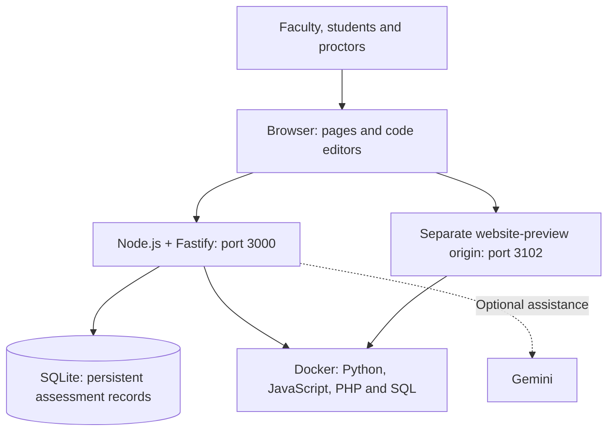
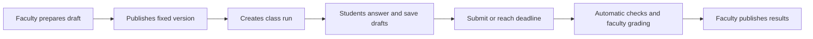

# Understand the system

[Documentation contents](../README.md) · Next: [run it locally](RUN_LOCALLY.md)

Got It! is an online assessment platform with a coding lab. Think of it as an exam center: the browser is the desk, the server is the examiner, the database is the records cabinet, and Docker supplies temporary computers for student programs.

## What each part does

| Part              | Everyday explanation                                      | Main source                                                                          |
| ----------------- | --------------------------------------------------------- | ------------------------------------------------------------------------------------ |
| Role pages        | Different desks for faculty, students and proctors        | [public/](../../public/)                                                             |
| Vue + CodeMirror  | The code-writing area inside the pages                    | [web/](../../web/)                                                                   |
| Vite              | Packages editor code into browser-ready assets            | [vite.config.mts](../../vite.config.mts)                                             |
| Node.js + Fastify | Serves pages and enforces access, deadlines and actions   | [server.mjs](../../src/server.mjs), [routes/](../../src/routes/)                     |
| Assessment engine | Validates questions and evaluates supported answers       | [engine.mjs](../../src/engine.mjs)                                                   |
| SQLite            | Remembers classes, versions, drafts, attempts and results | [store.mjs](../../src/store.mjs)                                                     |
| Docker runtimes   | Run student programs with resource limits                 | [code-runner.mjs](../../src/code-runner.mjs), [terminal.mts](../../src/terminal.mts) |
| Preview service   | Shows student-created websites on a separate origin       | [web-preview.mts](../../src/web-preview.mts)                                         |
| Optional AI       | Drafts questions and suggests grades for faculty review   | [ai.mjs](../../src/ai.mjs), [ai-grading.mjs](../../src/ai-grading.mjs)               |

Most role pages use HTML and JavaScript; Vue supplies the richer editors. Node runs the main application. PHP runs inside Docker for exercises. The supported setup does not need a separate MySQL server or a host PHP installation.

## From questions to results

A **version** is a particular question set. Publishing fixes its content. A **run** is one scheduled delivery of that version to a class. An **attempt** is one student's work in that run.

The server checks the roster, PIN and time window. Drafts are saved so refresh and rejoin can recover work. Finishing or reaching the deadline settles eligible saved answers, subject to retry limits.

| Answer kind                   | What happens now                                                              |
| ----------------------------- | ----------------------------------------------------------------------------- |
| Objective and table questions | The server evaluates the supported private rules                              |
| Console code                  | Submission is saved for faculty grading; Run code only shows execution output |
| Web project                   | Manual rubrics need faculty grading; older packages may also have HTTP checks |
| Optional AI grade check       | Returns a suggestion; faculty must save the grade                             |
| Graded results                | Remain hidden until faculty explicitly publishes them                         |

## Where the data lives

The application SQLite database is persistent. A student's PHP exercise can also have a separate SQLite database inside its temporary workspace; saved project data provides recovery. These are different databases with different jobs.

Startup normally uses a separate migration copy of the configured database. Read [backup and recovery](../operations/BACKUP_AND_RECOVERY.md) before copying records or running maintenance.

You can run Docker on the same host for a pilot, or move execution to the existing [optional worker](../operations/DEPLOYMENT.md#optional-separate-execution-worker). The API and private grading records stay on the application host.
